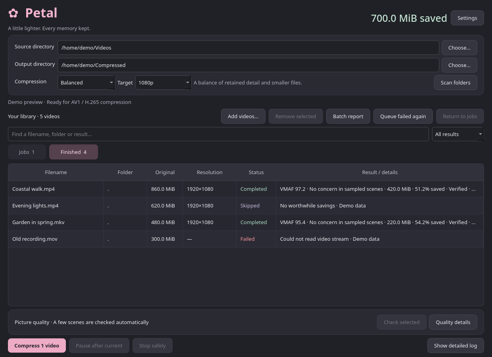
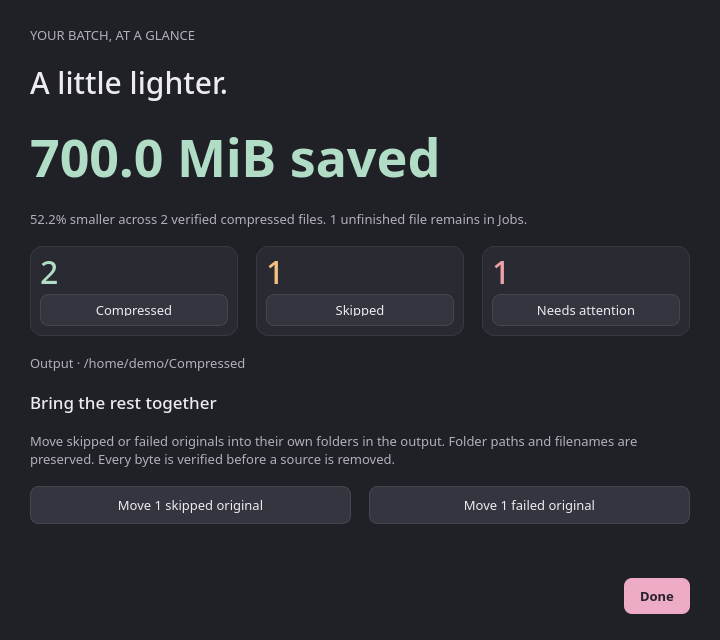
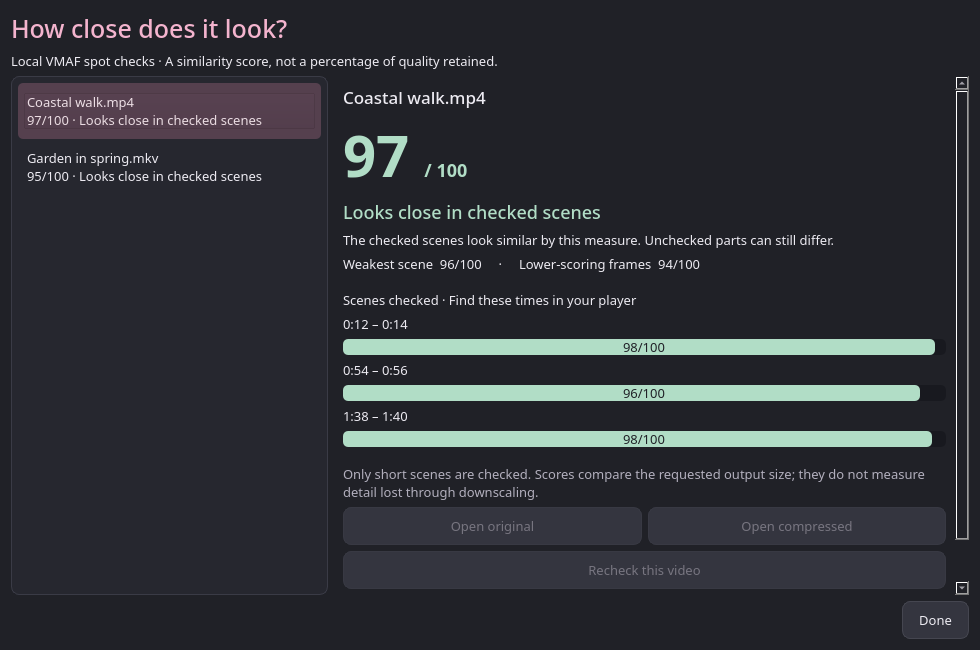

<div align="center">


# Petal

**Careful GPU video compression for Linux.**

A native desktop app for compressing video collections with AMD VA-API.
Review your queue, keep your originals, and inspect measured picture quality.

[Download AppImage](https://github.com/lkotlarenko/petal/releases/latest) · [Usage](docs/USAGE.md) · [Quality guide](docs/QUALITY.md) · [Contributing](CONTRIBUTING.md)

[](https://github.com/lkotlarenko/petal/actions/workflows/ci.yml)
[](https://github.com/lkotlarenko/petal/actions/workflows/release.yml)

</div>



*Actual Qt interface with demonstration filenames and values; these are not benchmark results.*

## What Petal does

- Batch AV1 or H.265 compression with one VA-API encoder; verification overlaps the next encode.
- Drag in files or folders, preserve folder hierarchy, and choose an output resolution from 480p to 4K or Original.
- Read metadata with two bounded readers and reuse a persistent discovery cache on repeat scans.
- Inspect local VMAF spot checks with a large colored score, scene bars and links to both videos.
- Pause, stop safely, retry failures and resume recorded completions.
- Compression keeps originals in place and never replaces existing outputs.
- Review a colored batch report, then optionally move skipped/failed originals with full-byte verification.
- Keep Jobs and Finished separate, with persistent results, search, filters and useful right-click actions.

Compression publishes worthwhile, verified outputs. Afterward, you can explicitly move skipped or failed originals into `skipped/` or `failed/` inside the output, preserving their relative paths. Use your own backup process for a complete library copy.

## Download and run

Get the Linux x86_64 AppImage and its `.sha256` file from [Releases](https://github.com/lkotlarenko/petal/releases/latest):

```bash
sha256sum -c Petal-<version>-x86_64.AppImage.sha256
chmod +x Petal-<version>-x86_64.AppImage
./Petal-<version>-x86_64.AppImage
```

Release builds target Ubuntu 24.04 or newer compatible Linux distributions, including current Arch/CachyOS. Python and Qt are bundled. **FFmpeg, FFprobe, Fontconfig, VA-API drivers and access to `/dev/dri/renderD*` are system requirements.** AMD Mesa/radeonsi is the tested application target; other GPU vendors are not validated. Optional VMAF needs an FFmpeg build with `libvmaf` and its built-in models. Metric unavailability does not prevent integrity verification.

On Arch/CachyOS:

```bash
sudo pacman -S --needed ffmpeg libva-utils mesa
```

If FUSE is unavailable, run with `APPIMAGE_EXTRACT_AND_RUN=1 ./Petal-<version>-x86_64.AppImage`. No system-wide installation is required. See [troubleshooting](docs/USAGE.md).

## Run from source

```bash
git clone https://github.com/lkotlarenko/petal.git
cd petal
sudo pacman -S --needed python pyside6 ffmpeg libva-utils mesa qt6-wayland qt6-svg
./launch.sh
```

For an isolated installation, use Python 3.11+ with `python3 -m venv .venv` and `.venv/bin/python -m pip install -r requirements.txt`. System media dependencies still apply. Optional application-menu entry: `python3 scripts/install-desktop.py`.

## First compression

1. Let the hardware check finish. Petal validates actual encode/decode combinations before enabling them.
2. Choose separate source and output directories, or drop local videos into the window.
3. Scan and review the queue. Repeat scans reuse unchanged metadata; encoding always probes again.
4. Use **Settings → Compare selected video samples** on representative content. The default quality profiles are starting points, not calibrated guarantees.
5. Start a small batch, inspect the results, then expand to your collection.

Audio is copied by default. Maximum compatibility preserves supported tracks, represents timecode as metadata and converts supported text subtitles; strict copying and explicit omission are selectable. Unsupported HDR, interlacing and unusual formats are skipped with explanations. See [complete media and safety policy](docs/REFERENCE.md).

## Review and organize a batch



The report opens when a batch finishes and remains available through **Batch report**. It shows saved space and compressed, skipped and failed counts. Click a count to see those files in Finished. Choose **Move skipped originals** or **Move failed originals** to put them in `output/skipped/` or `output/failed/`, preserving their source-relative paths and original extensions. Moves require confirmation, refuse overwrites, and verify full SHA-256 checksums before removing originals.

**Jobs** holds waiting or interrupted work; **Finished** holds results. Both persist across restarts. Add videos or drag folders, search and filter, right-click to open files/folders, inspect details, return files to Jobs, or remove list entries without deleting media. Right-click a table header for optional columns. Engine controls remain in Settings.

For a collection processed by an older Petal version, scan the same folders to recognize unchanged recorded completions. Earlier skipped/error states were not saved, so remaining rows stay in Jobs. If you want to set those aside without encoding, select them, choose **Skip selected**, and use the report's move action. Petal does not guess which older files failed. [Organization, safety and recovery](docs/ORGANIZING.md).

To add the AppImage to your application menu with its icon, move it to its permanent location and use **Settings → Add AppImage to applications**, or run `./Petal-<version>-x86_64.AppImage --install-desktop`. File-manager AppImage thumbnails also depend on desktop support; the package includes a raster icon, `.DirIcon` and standard icon-theme sizes.

## Picture quality at a glance



*Demonstration scores. VMAF compares short samples, not the entire file.*

Mint means no concern in the checked scenes; amber or rose suggests visual comparison. Each scene bar includes its time and score. The score measures similarity at the output resolution, not the percentage of quality retained or the separate detail loss from downscaling.

A decoded/container frame-size mismatch shows **Frame size needs attention**, hiding misleading scores. New mismatched outputs fail verification before publication. Existing outputs are retained for inspection. Read [quality interpretation and geometry troubleshooting](docs/QUALITY.md).

## Development and releases

```bash
./scripts/test.sh
./launch.sh --version
./launch.sh scan /path/to/Videos /path/to/Compressed
```

Every successful `main` release workflow selects the next patch version automatically, runs tests, builds an AppImage, tests the packaged CLI and native GUI, and publishes a GitHub release with the AppImage and checksum. Pull requests run tests without publishing. No personal access token is required.

- [Contributing and test setup](CONTRIBUTING.md)
- [Architecture and tuning](docs/DESIGN.md)
- [Release process and local packaging](docs/RELEASING.md)
- [Verification evidence and limits](docs/TEST_REPORT.md)
- [Full controls, CLI and safety reference](docs/REFERENCE.md)
- [GPLv3 license](LICENSE) · [Third-party notices](THIRD_PARTY.md)

GPU throughput and driver compatibility must be checked on the target host. Software fixtures and offscreen Qt tests do not establish hardware compatibility.
